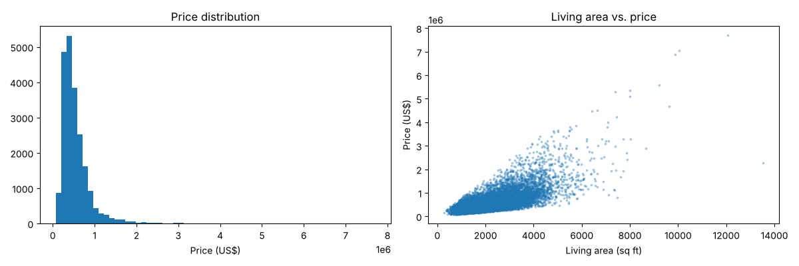

# House Price Prediction

A machine learning model that predicts house sale prices from square footage, number of bedrooms and bathrooms, location and year built.



## Data

House sales in King County (Seattle, USA) between 2014 and 2015, covering 21,613 homes.
Source: [Kaggle: House Sales in King County, USA](https://www.kaggle.com/datasets/harlfoxem/housesalesprediction).

## Tools

Python, pandas, scikit-learn, matplotlib

## Models

- Linear Regression
- Decision Tree

Results (mean absolute error and R²) are in the notebook [`notebooks/analysis.ipynb`](notebooks/analysis.ipynb).

## How to run

```bash
pip install -r requirements.txt
jupyter notebook notebooks/analysis.ipynb
```

